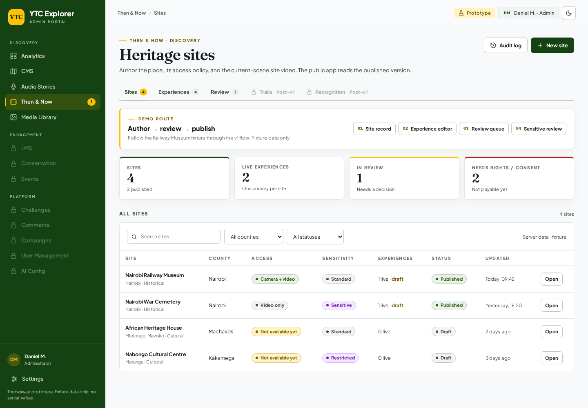
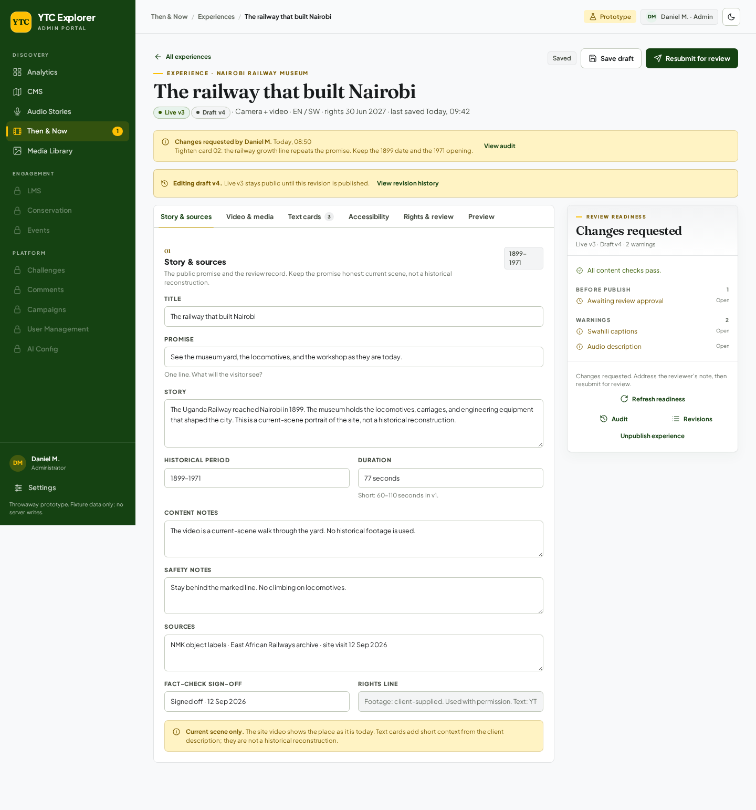
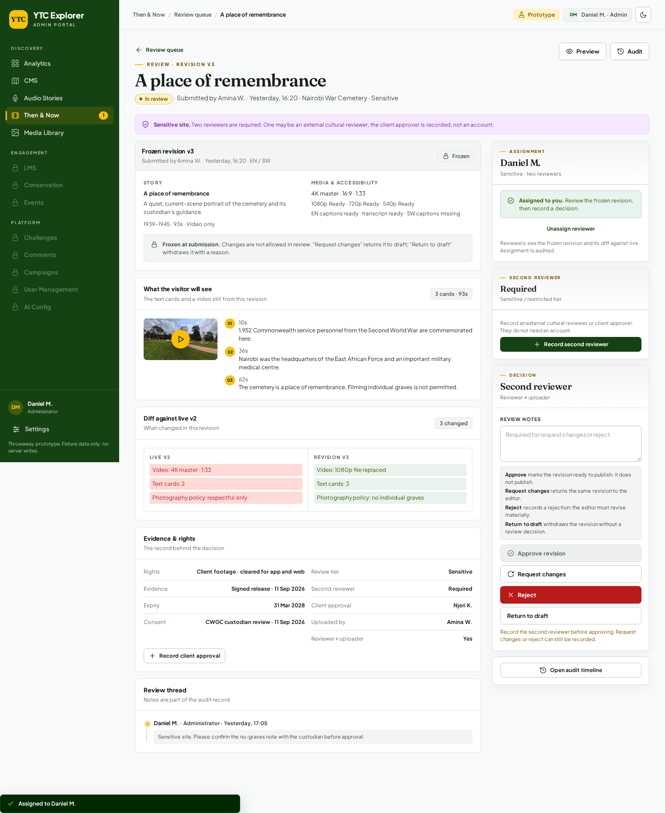
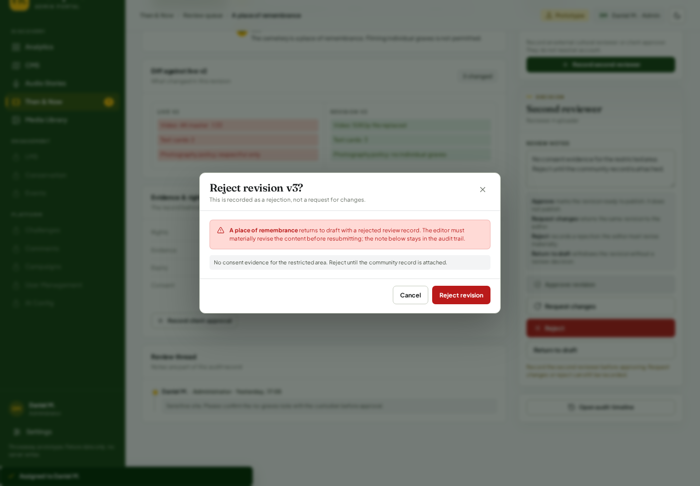
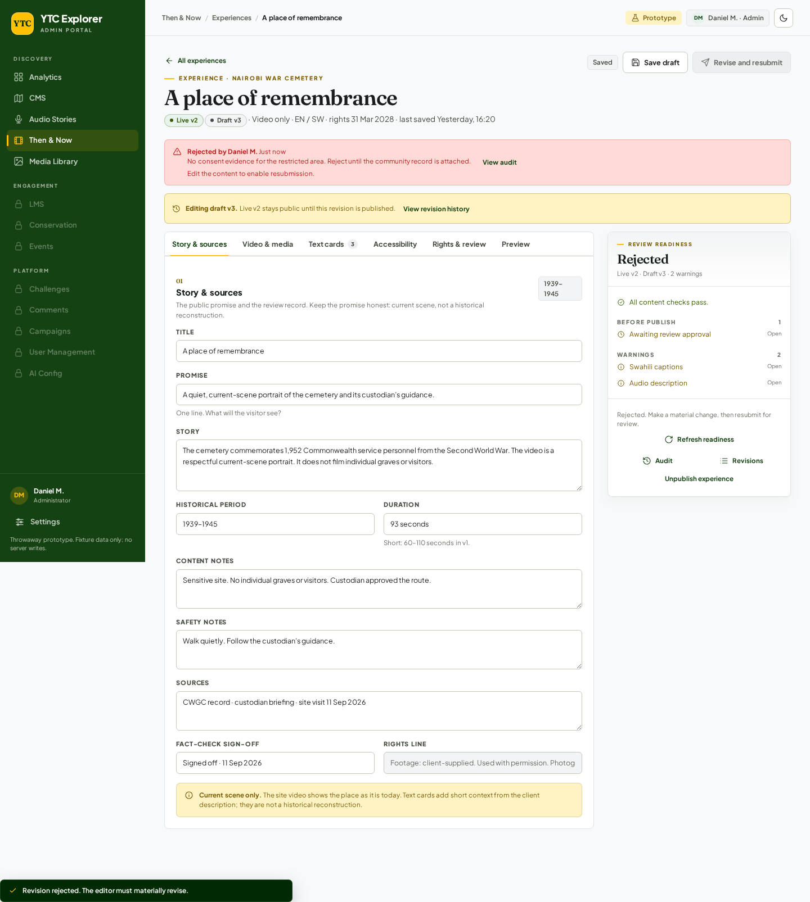
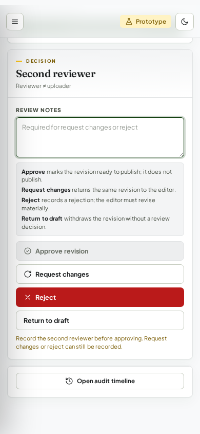

# Then & Now admin authoring prototype

Throwaway prototype for #283. It answers: **how should a non-technical admin author, review, and publish a Then & Now experience?**

The artifact is a single static HTML page with inline fixture data. It does not call the API, persist anything, or upload media.

## Review status

Impeccable critique: **31/40** (target ≥ 30), no P1. Known limit: the post-rejection resubmission gate compares story, sources, and text-card content; rights and consent fields are read-only in this prototype, so a rejection about rights evidence cannot be resolved here. Rights and media edits are mocked.

## Run

From the repository root:

```sh
python3 -m http.server 4173 --directory docs/prototype
```

Open <http://localhost:4173/then-now-admin.html>.

Opening `then-now-admin.html` directly also works in most browsers; the assets are relative.

## Demo route

1. **Sites** → Nairobi Railway Museum.
2. **Experiences** → *The railway that built Nairobi*.
3. Edit the draft, then **Submit for review**.
4. The revision appears in the **Review queue**; assign it to yourself and approve.
5. **Schedule publish (EAT)** or **Publish now**. The live revision updates.
6. Use the **Prototype** control in the top bar for the empty, loading, error, offline, 409 conflict, sensitive-review, and read-only scenarios; switch the role to content editor, admin, super-admin, or moderator.

## Screens

| | |
|---|---|
|  |  |
|  |  |
|  |  |

## Scope

- **In v1:** Sites, Experiences, Review; identity/policy/location; current-scene video and video files; 2–3 text cards; EN/SW accessibility; rights and consent; readiness rail; staged revisions; review; schedule/publish; audit; watermarked preview; archive/revoke.
- **Post-v1:** Trails and Recognition are shown as locked tabs. Camera anchors, bearing/pitch, ghost frames, guided 360°, and the Story cut are explicitly out of the v1 prototype. The Location tab uses a 150 m site geofence.
- The four site photos are illustrative fixtures, not cleared client stills.

## Prototype notes

- The readiness rail mirrors the server contract; the UI never decides publishability.
- The review flow enforces reviewer ≠ uploader and a second reviewer for sensitive/restricted tiers.
- The client approver and external cultural reviewer are recorded by an administrator; they do not get accounts.
- The 409 conflict, offline, empty, loading, permission, upload-error, and sensitive states are available from the prototype panel or the review fixtures.
